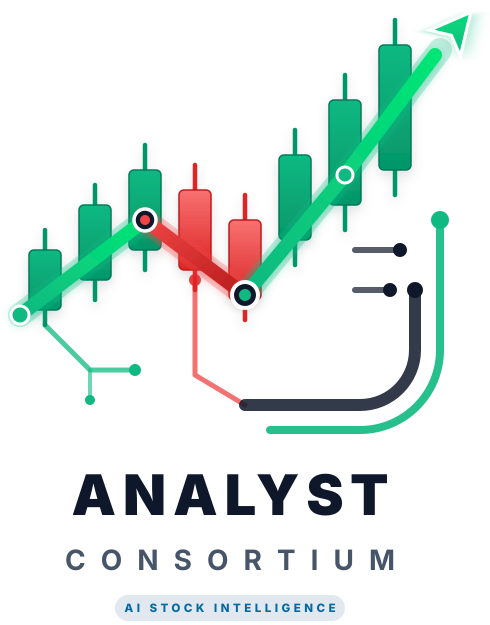

<p align="center">
  
</p>

<h1 align="center">Analyst Consortium</h1>

<p align="center">A team of AI analysts that reads the public data on a stock, argues both sides, and writes up a rating with its reasons.</p>

> **Analyst Consortium is a modified version of [TradingAgents](https://github.com/TauricResearch/TradingAgents) by Tauric Research** (Apache License 2.0), started from v0.7.1. We changed some of the original files and added many new ones; **[CHANGES-FROM-UPSTREAM.md](CHANGES-FROM-UPSTREAM.md)** says exactly what. It is not affiliated with or endorsed by Tauric Research.
>
> **It is a research tool, not financial advice.** It never places a trade, and a rating is an AI's reading of public data on one day. We have not shown that it makes money.

**On this page:** [What it does](#what-it-does) · [What is different from the original](#what-is-different-from-the-original) · [Install](#install) · [Using the web page](#using-the-web-page) · [The command line](#the-command-line) · [Keys and data sources](#keys-and-data-sources) · [Your files and your privacy](#your-files-and-your-privacy) · [What a run costs](#what-a-run-costs) · [Use it from Python](#use-it-from-python) · [Make it your own](#make-it-your-own) · [Updating](#updating) · [What we have not shown](#what-we-have-not-shown) · [Name, logo and trademark](#name-logo-and-trademark) · [Credits, license and citation](#credits-license-and-citation)

## What it does

You give it a stock symbol and a date. A team of AI agents, each with its own job, does the rest:

1. **Analysts** gather data at the same time: a market (price and indicators) analyst, a sentiment analyst, a news analyst and a fundamentals analyst. Each writes a report.
2. **A bull and a bear** argue the case for and against. The Research Manager weighs the debate.
3. **A trader** proposes a plan, **three risk debaters** (aggressive, neutral, conservative) argue about it, and the **Portfolio Manager** makes the final call.

The result is one of five ratings, Buy, Overweight, Hold, Underweight or Sell, with a 0 to 100 conviction score (Sell 0-20, Underweight 21-40, Hold 41-59, Overweight 60-79, Buy 80-100), the reasoning behind it, and the data it used. It is saved as one self-contained HTML page, and from the web page also as a CSV or a PDF.

The roles, the debate and the order of the steps are the original project's idea; its paper is credited [below](#credits-license-and-citation).

## What is different from the original

The full list is in [CHANGES-FROM-UPSTREAM.md](CHANGES-FROM-UPSTREAM.md), with every changed and added file. The short version:

- **A sharper research stage.** The debate runs five times and the median rating wins, so a borderline stock does not flip between neighboring ratings from one run to the next. The bull, the bear and the manager argue from one shared fact sheet worked out in code. A market-wide selloff is told apart from a company in trouble.
- **Eleven new data tools** for the analysts: earnings, trends, valuation, ownership and short interest, options and volatility, market context, SEC filing events, what management said, macro conditions, public records and Congress trades.
- **A local web page** (`tradingagents ui`) to check your setup, set the AI connection and keys, start analyses, watch the analysts work and save the reports.
- **A free stock picker**, which uses no AI, with three ways to look, a record of every list it showed, and a scoreboard that compares those lists with the S&P 500 later.
- **Command-line additions:** `doctor`, `ui`, `pick` and `shortcut`.
- **Our own name and look** on the reports, with the original credited by name and link.

The changes to the analysis can each be switched back to the original's behavior; the table in the changes page says how.

## Install

**You need** Python 3.11 or later, an account with one AI provider (an API key, a ChatGPT Plus or Pro plan, or a local model server such as Ollama), and an internet connection. We built and tested this on Windows 11 with Python 3.13. The engine is plain Python and the original runs on Windows, macOS and Linux. Our automated tests also pass on Linux with Python 3.11, 3.12, 3.13 and 3.14 (GitHub runs them on every change), but nobody has used our additions by hand on macOS or Linux.

**1. Get the code.** With git, clone it and step into the new folder:

```bash
git clone https://github.com/NormanSisk/analyst-consortium.git
cd analyst-consortium
```

Or use the green Code button on the repository's page, choose Download ZIP, unzip it and open a terminal in that folder.

**2. Make a private Python environment inside it:**

```bash
python -m venv .venv
```

Switch it on (the prompt changes). On Windows PowerShell:

```powershell
.venv\Scripts\Activate.ps1
```

On macOS or Linux:

```bash
source .venv/bin/activate
```

If PowerShell refuses to run that script, skip it: every command below also works when you start it with the folder's own copy, for example `.venv\Scripts\tradingagents ui`.

**3. Install it,** with the libraries the web page needs. The `-e` makes it editable, so a change you make to the files shows the next time it starts:

```bash
pip install -e ".[ui]"
```

**4. Open the web page:**

```bash
tradingagents ui
```

Your browser opens to the page. The first thing on it is **Setup and settings**, which stays open until your setup is complete. Pick your AI provider and models, paste your key, and the page tells you in plain words what else is missing, until it says **READY TO RUN: YES**. Then it folds itself away, and one click on its label opens it again.

**5. Optional: a desktop shortcut,** so a double-click opens the page with no typing:

```bash
tradingagents shortcut
```

On Windows this makes a real shortcut with the app's icon. On macOS it writes a `.command` file and on Linux a `.desktop` entry; those two are written from the systems' documentation and have not been tried. `tradingagents shortcut --remove` takes it away again.

To check your setup at any time without the web page, run `tradingagents doctor`. It changes nothing and never prints a key.

The original's `Dockerfile` and `docker-compose.yml` are still in the folder. We have not tried them with our additions.

## Using the web page

`tradingagents ui` starts a small server that answers only on your own computer. If it is already open, running it again just brings up the page that is running.

- **Setup and settings** at the top: the AI connection, your keys, data sources, features, and the check list. Keys are written to your `.env` file and are never sent back to the page; the page learns only whether one is set.
- **Run an analysis.** Enter up to ten stocks, choose the analysts, the depth, the number of research passes, the investing style (standard or growth) and the language. You see a cost estimate first, you can follow the progress, and you can stop a run.
- **Watch it work.** The live view shows what each analyst says and asks for, and it can be switched off.
- **Reports.** The HTML report opens when a run finishes. Any finished analysis can be saved as CSV or PDF. (PDF needs Microsoft Edge or Google Chrome installed; it is made from the HTML report.)
- **Finding your reports.** The left column has an **Open the reports folder** button under the maker's link. It opens the folder that holds every saved report in your file manager, and the line under it says where that folder is. Each analysis has its own folder inside, with `complete_report.html` to open. Before the first analysis there is no folder yet, and the button says so.
- **Clearing the list.** Under **Your analyses**, each finished, failed or stopped analysis has a **Remove from the list** button, and **Clear the finished analyses from this list** clears them all (it asks first; anything waiting or running stays). This clears only the page's list. Saved reports, the run records under your results folder and the decision memory log are not deleted, so they are yours to delete in your file manager.
- **Find stocks,** free and with no AI calls. Three ways to look: **Beaten-down quality** (large US stocks well below their highs where the market explains the fall), **Your own list**, and **Custom search** with about 25 optional filters and a count of matches before you search. Every stock is checked against the same five deal conditions and shown as PASS, FAIL or UNKNOWN with the numbers behind it. Tick the ones you want and send them to the run form.
- **Scoreboard.** Lists you record are compared later with the S&P 500 at 5, 21 and 63 trading sessions. It says "too early" until there is enough to look at, and it never calls a result proof.

The page is built to be easy to read. Every status is a symbol and a word, never color alone. Text and background pairs are checked for AAA contrast (at least 7:1). There are three color themes, including high contrast, two text sizes (Normal and Larger; your last choice is remembered) and no sideways scrolling.

## The command line

```bash
tradingagents                          # asks you questions, then runs an analysis
tradingagents --ticker NVDA --date 2026-11-06 --analysts market,news,fundamentals --save --no-show
tradingagents doctor                   # check the setup in plain words
tradingagents ui                       # the web page
tradingagents shortcut                 # a desktop launcher
tradingagents pick beaten-down         # the free quick look, largest US stocks well below their highs
tradingagents pick list NVDA MU TSM    # the same checks on stocks you name
tradingagents pick scoreboard          # how recorded lists did against the S&P 500
tradingagents backtest NVDA,AAPL --start 2026-06-01 --end 2026-08-01 --every 7
tradingagents login chatgpt            # sign in with a ChatGPT Plus or Pro plan
```

Add `--help` to any of them for the options. After a borderline call the bare command offers two more analyses and a combined verdict; `--no-rerun` turns that off. Run without a terminal (a scheduled job, a script), it never asks a question: answer the per-run steps with flags and the rest with `TRADINGAGENTS_*` variables, and a missing answer stops the run before it starts and names the flag or variable to set.

## Keys and data sources

**One AI provider is required.** Set the key for the one you use, in the web page or in your `.env` file (copy `.env.example` to `.env` to start from the full list): OpenAI, Google, Anthropic, xAI, DeepSeek, Qwen, GLM (Zhipu), MiniMax, OpenRouter, Mistral, Moonshot (Kimi), Groq or NVIDIA. Other ways in: your own ChatGPT Plus or Pro plan (`tradingagents login chatgpt`), Amazon Bedrock (`pip install -e ".[bedrock]"`), a local Ollama server, or any OpenAI-compatible server. Our own testing used Anthropic's Claude models. The other providers come from the original project, and we have not tried our additions with them.

**Data sources.** Most need no key and no account:

| Source | What for | Key |
| --- | --- | --- |
| Yahoo Finance | prices, statements, options, news, the stock picker | none |
| SEC EDGAR | company filings and statements as originally filed | none; set `SEC_EDGAR_USER_AGENT` to your name and address, as the SEC asks |
| FINRA, USAspending, ClinicalTrials.gov, FDA recalls | short-sale data and public records | none |
| StockTwits and Reddit | the sentiment analyst | none |
| FRED | credit spreads, financial conditions, next data releases | `FRED_API_KEY`, free |
| Quiver | Congress trades and insider trades | `QUIVER_API_KEY` |
| Alpha Vantage | earnings call transcripts | `ALPHA_VANTAGE_API_KEY` |
| TypeSafe Jev | screens social posts before the sentiment analyst reads them | `TYPESAFE_API_KEY`, optional |

A source without its key is skipped, and `tradingagents doctor` shows which are set.

## Your files and your privacy

- **Your keys and settings** live in a `.env` file. The program finds it in the folder you start from, or in a folder above that. It is excluded from the repository by `.gitignore`, and nothing prints it. The shortcut starts from the folder that holds it.
- **Your results** (reports, the run log, the decision memory log, the cache and the picker's record of lists) go under `.tradingagents` in your home folder unless you point `TRADINGAGENTS_RESULTS_DIR`, `TRADINGAGENTS_CACHE_DIR` and `TRADINGAGENTS_MEMORY_LOG_PATH` somewhere else. A `data` folder inside the project, a holdings file (`my_book*.json`) and certificate files are also excluded from the repository, so they are never uploaded by mistake.
- **The web page** listens on `127.0.0.1` only, so only this computer can reach it. It checks the `Host` and `Origin` of every request, requires a random per-session token on every call and sends a strict content-security policy, so other web sites open in your browser cannot reach it.
- **What it connects to:** your AI provider (the symbols you analyze and the data the agents read go there, as in any AI tool), the data sources in the table above, and, in the command line only, a once-a-day background check of this project's GitHub releases for a newer version. It sends nothing about you or your runs, and no other server is asked. Turn it off with `TRADINGAGENTS_NO_UPDATE_CHECK=1`.

## What a run costs

You pay your AI provider. The five-pass debate costs about five times a single pass. With Anthropic's Haiku and Sonnet models we measured about $0.40 and six minutes per stock at five passes. Your cost depends on the models, the depth and the stock, and the run form shows an estimate before you start. `TRADINGAGENTS_RESEARCH_PASSES=1` gives the original's single pass. The stock picker costs nothing: it calls no AI.

## Use it from Python

```python
from tradingagents.graph.trading_graph import TradingAgentsGraph
from tradingagents.default_config import DEFAULT_CONFIG

config = DEFAULT_CONFIG.copy()
config["research_passes"] = 1            # our default is 5; 1 is the original's single pass
ta = TradingAgentsGraph(debug=True, config=config)

state, decision = ta.propagate("NVDA", "2026-11-06")
print(decision)
ta.save_reports(state, "NVDA")           # the same report folder the command line saves
```

`tradingagents/default_config.py` lists every setting, and each can also be set with a `TRADINGAGENTS_*` variable. Everything the original offers still works as it did, and is described in [its README](https://github.com/TauricResearch/TradingAgents#readme): giving the agents your holdings (`--portfolio my_book.json`), the dating of SEC EDGAR statements, checkpoint and resume, and backtests.

## Make it your own

It is plain Python, with plain HTML, CSS and JavaScript for the page, so you can change what you like. With the `-e` install above, an edit shows the next time you start it (the page's own files show on a refresh). To run the tests (no network, no AI calls):

```bash
pip install -e ".[dev]"
python -m pytest -q
```

- **The switches back to the original's behavior** are in the table in [CHANGES-FROM-UPSTREAM.md](CHANGES-FROM-UPSTREAM.md#what-behaves-differently-from-the-original-by-default).
- **A small promotion.** The page's side column has a "From the maker of this app" block that links to AeroPlanimetry (aeroplanimetry.com), a mapping website owned by the author. It is one marked block in `tradingagents/ui/static/index.html`; delete it if you do not want it.
- **If you share a changed copy** under a name of your own, please replace the logo; see [Name, logo and trademark](#name-logo-and-trademark).

## Updating

If you cloned it, run `git pull` in the folder. A download needs downloading again. Your keys, settings and results are not in the repository, so an update does not touch them. If an update adds a library, run the install command again:

```bash
pip install -e ".[ui]"
```

`CHANGELOG.md` has our release notes at the top, starting with 0.8.0, and the original project's release history below them, through v0.7.1. The command line tells you at start-up when a newer release is published on this project's GitHub page; turn that off with `TRADINGAGENTS_NO_UPDATE_CHECK=1`.

## Questions, bugs and security

- **A question or an idea:** [Discussions](https://github.com/NormanSisk/analyst-consortium/discussions).
- **A bug:** [Issues](https://github.com/NormanSisk/analyst-consortium/issues). Say what you ran, what you expected, what happened and which release you have. Never paste your keys or your holdings file.
- **A security problem:** report it privately, as [SECURITY.md](SECURITY.md) describes, and not in a public issue.

## What we have not shown

- **That it makes money.** We have not tested that. A rating is an AI's reading of public data on one day.
- **That our changes improve its calls.** Our tests (the selloff rules, the new data tools, the research panel, the analyst track-record study, the picker spot checks) show that the changes work as intended and did not wreck the ratings. They do not show better returns. [CHANGES-FROM-UPSTREAM.md](CHANGES-FROM-UPSTREAM.md#what-we-measured-and-what-we-have-not-shown) has the details.
- **That two runs agree.** Language models are not deterministic, and the news and social sources change by the hour, so two runs of the same stock and date can differ. The five-pass median steadies borderline calls but does not remove the variation.
- **That the free data is right.** Yahoo Finance's feeds are free and unofficial; they can be late, incomplete or wrong, and the reports say when something was missing.
- **That it works everywhere.** See [Install](#install): our tests pass on Linux, but nobody has used our additions by hand on macOS or Linux, and Docker and AI providers other than Anthropic are untried.

## Name, logo and trademark

"Analyst Consortium" is the name of this modified version. **The Analyst Consortium logo is a trademark (TM) of Norman R. Sisk**, claimed by use and not registered, and its artwork is copyright 2026 Norman R. Sisk, all rights reserved. The Apache License covers the code and the documents in this repository; it does not cover the logo and grants no right to use it. You are welcome to copy, change and share the program; if you share a changed copy under a name of your own, replace the logo with yours. An unmodified copy, and a plain reference that says this program exists and links to it, may show the logo. The files are `tradingagents/assets/analyst-consortium-logo.svg` (the logo as supplied), `tradingagents/assets/analyst-consortium-emblem.svg` (the symbol alone) and `assets/analyst-consortium-logo-on-white.svg` (a copy on a white card, for this page). [NOTICE](NOTICE) has the full wording.

"TradingAgents" and "Tauric Research" are the names of the original project and its authors, used here only to say where this came from. This work is not affiliated with or endorsed by them, and it does not use their logo.

## Credits, license and citation

Analyst Consortium is built on **TradingAgents** by Yijia Xiao, Edward Sun, Di Luo and Wei Wang of [Tauric Research](https://github.com/TauricResearch/TradingAgents), released under the Apache License 2.0. The roles, the debate and most of the engine are theirs. Our changes and additions are copyright 2026 Norman R. Sisk under the same license; see [LICENSE](LICENSE), [NOTICE](NOTICE) and [CHANGES-FROM-UPSTREAM.md](CHANGES-FROM-UPSTREAM.md).

If the ideas help your own work, please cite the original paper:

```
@misc{xiao2025tradingagentsmultiagentsllmfinancial,
      title={TradingAgents: Multi-Agents LLM Financial Trading Framework},
      author={Yijia Xiao and Edward Sun and Di Luo and Wei Wang},
      year={2025},
      eprint={2412.20138},
      archivePrefix={arXiv},
      primaryClass={q-fin.TR},
      url={https://arxiv.org/abs/2412.20138},
}
```
